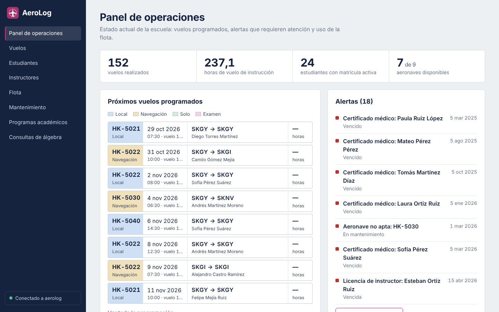

# AeroLog – Aplicación web

Aplicación web de demostración del proyecto final de **Bases de Datos 1** (Universidad El Bosque).
Se conecta a la base de datos PostgreSQL del sistema AeroLog, una escuela de aviación civil simulada, y permite **consultar** su información académica, de operaciones de vuelo y de mantenimiento.

Integrantes: Nicolás Rincón, Laura Morales, Juan Diego Contreras.
Docente: Ing., Esp., M.Ed. Christian Felipe Duarte.



## Arquitectura

```
Navegador (HTML + CSS + JavaScript)
        │  fetch /api/...  (JSON)
        ▼
Backend Flask (Python 3)  ── app/api.py: endpoints REST de solo lectura
        │  psycopg 3
        ▼
PostgreSQL 18 en la VM Oracle Linux 9  (base de datos aerolog, usuario aerolog_app)
```

| Capa | Tecnología | Archivos |
|---|---|---|
| Frontend | HTML, CSS y JavaScript sin dependencias externas | `app/static/` |
| Backend | Flask 3 (API REST) | `app/__init__.py`, `app/api.py` |
| Acceso a datos | psycopg 3 | `app/db.py` |
| Base de datos | PostgreSQL 18 | `database/*.sql` |

La aplicación usa el usuario `aerolog_app`, que **solo tiene permisos de lectura** (principio de mínimo privilegio). Todas las consultas usan parámetros, nunca concatenación de texto, para evitar inyección SQL.

### Módulos de la interfaz

- **Panel de operaciones**: indicadores, próximos vuelos, alertas (certificados vencidos, aeronaves no aptas, licencias por vencer, órdenes abiertas) y uso de la flota.
- **Vuelos**: programación y registro con filtros por estado, tipo, aeronave y fechas; detalle con ruta, maniobras evaluadas e informe.
- **Estudiantes**: búsqueda; detalle con matrículas, avance de horas, bitácora de vuelo y calificaciones.
- **Instructores**: licencias, habilitaciones y vuelos impartidos.
- **Flota**: estado de cada aeronave, certificado de aeronavegabilidad, mantenimiento e instructores habilitados.
- **Mantenimiento**: órdenes de trabajo, técnicos y repuestos con su costo.
- **Programas académicos**: plan de estudios y desempeño por curso.
- **Consultas de álgebra**: las 65 preguntas del documento de álgebra relacional, ejecutadas en vivo.
- **Estado de la conexión**: servidor, usuario, versión de PostgreSQL y conteo de registros.

### Endpoints de la API

| Método y ruta | Descripción |
|---|---|
| `GET /api/estado` | Información de la conexión y conteo de registros |
| `GET /api/panel` | Indicadores, alertas y estadísticas |
| `GET /api/estudiantes?q=` | Lista y búsqueda de estudiantes (ignora tildes) |
| `GET /api/estudiantes/<id>` | Detalle del estudiante |
| `GET /api/instructores` | Instructores |
| `GET /api/aeronaves` · `GET /api/aeronaves/<matricula>` | Flota y detalle |
| `GET /api/vuelos?estado=&tipo=&matricula=&desde=&hasta=` | Vuelos con filtros |
| `GET /api/vuelos/<id>` | Detalle del vuelo |
| `GET /api/mantenimiento?estado=abiertas\|cerradas` · `GET /api/mantenimiento/<id>` | Órdenes de trabajo |
| `GET /api/academico` | Programas y plan de estudios |
| `GET /api/consultas` · `GET /api/consultas/<n>` | Catálogo y ejecución de las consultas de álgebra |

## 1. Preparar la base de datos en la VM

En la máquina virtual Oracle Linux 9 (ver el *Documento de implementación de la VM*):

```bash
# Instalar PostgreSQL 18 desde el repositorio oficial PGDG
sudo dnf install -y https://download.postgresql.org/pub/repos/yum/reporpms/EL-9-x86_64/pgdg-redhat-repo-latest.noarch.rpm
sudo dnf -qy module disable postgresql
sudo dnf install -y postgresql18-server
sudo /usr/pgsql-18/bin/postgresql-18-setup initdb
sudo systemctl enable --now postgresql-18
```

Permitir conexiones desde el equipo anfitrión (a través del reenvío de puertos de VirtualBox):

```bash
# Escuchar en todas las interfaces
sudo sed -i "s/^#listen_addresses = 'localhost'/listen_addresses = '*'/" /var/lib/pgsql/18/data/postgresql.conf
# Autenticación por contraseña para la red NAT de VirtualBox y para conexiones locales por TCP.
# Las líneas se insertan al inicio porque PostgreSQL aplica la primera regla que coincide.
sudo sed -i '1i host  aerolog  all  10.0.2.0/24   scram-sha-256\nhost  aerolog  all  127.0.0.1/32  scram-sha-256' /var/lib/pgsql/18/data/pg_hba.conf
sudo systemctl restart postgresql-18
```

Crear la base de datos y cargar los scripts (copie la carpeta `database/` a la VM o clone el repositorio):

```bash
sudo -u postgres psql -c "CREATE DATABASE aerolog;"
sudo -u postgres psql -d aerolog -f database/01_creacion_objetos.sql
sudo -u postgres psql -d aerolog -f database/02_insercion_registros.sql
sudo -u postgres psql -d aerolog -f database/03_usuarios_permisos.sql   # cambie antes las contraseñas
```

Verificación:

```bash
psql -h 127.0.0.1 -U aerolog_app -d aerolog -c "SELECT count(*) FROM vuelo;"
```

## 2. Ejecutar la aplicación

Se recomienda ejecutarla en el equipo anfitrión, que se conecta a PostgreSQL por el puerto 5432 reenviado a la VM. Requiere Python 3.10 o superior.

```bash
cd aerolog-app
python -m venv .venv
# Windows: .venv\Scripts\activate      macOS/Linux: source .venv/bin/activate
pip install -r requirements.txt
cp .env.example .env        # en Windows: copy .env.example .env
# edite .env con la contraseña de aerolog_app
python run.py
```

Abra **http://127.0.0.1:5000** en el navegador.

**Alternativa: ejecutarla dentro de la VM.** Instale Python (`sudo dnf install -y python3.12 python3.12-pip`), use `DB_HOST=127.0.0.1` y `APP_HOST=0.0.0.0` en `.env`, abra el puerto en el cortafuegos (`sudo firewall-cmd --permanent --add-port=5000/tcp && sudo firewall-cmd --reload`) y agregue en VirtualBox una regla de reenvío del puerto 5000 del anfitrión al 5000 de la VM.

## 3. Pruebas automáticas

Con la base de datos cargada y el archivo `.env` configurado:

```bash
python -m unittest -v
```

Las pruebas verifican la conexión, todos los endpoints, los filtros, la búsqueda sin tildes, los errores 400 y 404, y la ejecución de las 65 consultas de álgebra relacional.

## Documentación del proyecto

| Fase | Documento |
|---|---|
| 1 | [Documento de Supuestos](docs/fase1/01_Documento_de_Supuestos_AeroLog.pdf) |
| 1 | [Modelo Entidad-Relación – Peter Chen](docs/fase1/02_MER_Peter_Chen_AeroLog.pdf) |
| 1 | [Modelo Entidad-Relación Extendido](docs/fase1/03_MER_Extendido_AeroLog.pdf) |
| 1 | [Modelo Entidad-Relación – Crow’s Foot](docs/fase1/04_MER_Crows_Foot_AeroLog.pdf) |
| 1 | [Modelo Relacional – Crow’s Foot](docs/fase1/05_Modelo_Relacional_AeroLog.pdf) |
| 1 | [Diccionario de Datos](docs/fase1/06_Diccionario_de_Datos_AeroLog.pdf) |
| 1 | [Álgebra relacional (65 ejercicios)](docs/fase1/07_Algebra_Relacional_AeroLog.pdf) |
| 2 | [Análisis de selección del sistema operativo](docs/fase2/08_Analisis_Sistema_Operativo_AeroLog.pdf) |
| 2 | [Implementación de la máquina virtual](docs/fase2/09_Implementacion_Maquina_Virtual_AeroLog.pdf) |
| 2 | [Análisis de selección del RDBMS](docs/fase2/10_Analisis_RDBMS_AeroLog.pdf) |

Los diagramas en alta resolución están en [`docs/diagramas`](docs/diagramas), junto con el script `modelo_para_data_modeler.sql` para importar el modelo en Oracle SQL Data Modeler o MySQL Workbench.

## Estructura del proyecto

```
aerolog-app/
├── app/
│   ├── __init__.py        # creación de la aplicación y manejo de errores
│   ├── api.py             # endpoints REST
│   ├── config.py          # configuración desde .env
│   ├── db.py              # acceso a PostgreSQL
│   ├── consultas.json     # 65 ejercicios de álgebra relacional
│   └── static/            # frontend: index.html, css/, js/, img/
├── database/
│   ├── 01_creacion_objetos.sql
│   ├── 02_insercion_registros.sql
│   ├── 03_usuarios_permisos.sql
│   └── 04_consultas_algebra.sql
├── docs/                  # documentos PDF de las fases 1 y 2 y diagramas
├── tests/test_api.py
├── .env.example
├── requirements.txt
└── run.py
```

## Solución de problemas

| Síntoma | Causa probable y solución |
|---|---|
| El indicador lateral dice “Sin conexión a la base de datos” | La VM está apagada, PostgreSQL no está activo (`sudo systemctl status postgresql-18`) o el puerto 5432 no está reenviado. |
| `password authentication failed` | La contraseña de `.env` no coincide con la definida en `03_usuarios_permisos.sql`. |
| `no pg_hba.conf entry` o `Ident authentication failed` | Faltan, o no están al inicio de `pg_hba.conf`, las líneas `host aerolog all 10.0.2.0/24 scram-sha-256` y `host aerolog all 127.0.0.1/32 scram-sha-256`. |
| `ModuleNotFoundError: psycopg` | El entorno virtual no está activo o no se ejecutó `pip install -r requirements.txt`. |
| El puerto 5000 está ocupado | Cambie `APP_PORT` en `.env` (en macOS el puerto 5000 lo usa AirPlay). |

> Nota para desarrollo: si no es posible instalar psycopg, `DB_DRIVER=psql` hace que la aplicación ejecute las mismas consultas mediante el cliente `psql`. Úsela solo para pruebas.
